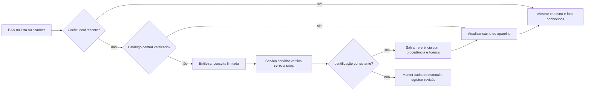

# Lumo — Catálogo vivo: produtos e fotografias que evoluem automaticamente

**Estado:** arquitetura e contratos da próxima etapa; não implica migração aplicada nem coleta já ativa no Supabase. O catálogo local por EAN e a consulta controlada no navegador existem no PR #3, enquanto a camada compartilhada abaixo será lançada separadamente após testes de autorização, origem e carga.

## Resultado pretendido

Quando qualquer usuário lê um EAN, o Lumo pode reconhecer descrição, marca, apresentação, foto frontal, procedência e data de verificação. A descoberta entra em um catálogo compartilhado **somente após validação automática de origem e código**; ela não inclui compras, clientes, notas, histórico, preferências, geolocalização nem dados pessoais. Em novo aparelho, uma leitura do mesmo EAN busca primeiro a referência compartilhada.

O Lumo nunca pode trocar sozinho a quantidade, o preço, o nome personalizado ou o status de um item privado. A imagem exibida corresponde ao mesmo EAN; havendo dúvida, mantém um ícone contextual e permite correção humana.

## Fluxo da descoberta

## Contrato de dados recomendado

**`public.catalog_products`** (somente leitura ao app): `gtin` (chave), `name`, `brand`, `package`, `category`, `image_url`, `image_source_url`, `source`, `source_license`, `image_license`, `verified_at`, `refresh_after`, `quality_score`, `status` (`verified`/`review`/`rejected`) e `updated_at`. A API só devolve linhas `verified`, sem credenciais e sem atributos pessoais. Usuários **não** têm `INSERT`, `UPDATE` ou `DELETE` nessa tabela. RLS é obrigatória.

**`private.catalog_candidates`**: candidatos e conflitos de fonte, com verificação e logs de integridade; acesso somente pelo serviço interno. **`private.catalog_jobs`**: EAN para revalidação, tentativas, falhas, próximo processamento e bloqueio temporário. Limpar registros temporários e aplicar quotas antes de habilitar produção.

**Edge Function `catalog-lookup`**: verifica sessão legítima (sem confiar em metadados editáveis), checksum GTIN, limites por conta/IP e origens permitidas. Compara código **retornado** com código **solicitado**. Apenas o serviço possui permissão de gravação; o navegador usa somente a chave pública. Toda atualização guarda nome da fonte, licença, URL original e data.

**Atualização diária agendada**: Supabase Cron aciona Edge Function com segredo restrito guardado no Vault, nunca no repositório ou frontend. Revalidar somente registros vencidos, em lotes pequenos, com limite e backoff para HTTP 429/503. A consulta ao abrir um produto pode trazer uma nova versão antes da tarefa diária.

## Política de atualização e UX

- **Primeira identificação:** consultar o catálogo interno; se não houver referência aprovada, consultar a fonte aberta por EAN e manter a experiência responsiva com ícone de fallback.
- **Validade do cache:** referências verificadas por até 14 dias; fotos que falharam devem ter retry com atraso. Um cache anterior pode continuar visível enquanto a fonte é revalidada, desde que preserve o mesmo GTIN.
- **Qualidade:** comparar identificador e embalagem; não usar fotos obtidas por similaridade de nomes ou resultados genéricos de imagens. Marcar mudanças suspeitas de marca/volume para revisão.
- **Imagem:** URL HTTPS autorizada com resolução adequada; sem armazenar cópia de foto de terceiros sem permissão e sem apagar sua atribuição.
- **Catalogar sem foto:** registrar o produto reconhecido mesmo que não exista fotografia, para melhorar o reconhecimento posterior; tratar dados em falta como dados em falta, sem inventar.
- **Acesso offline:** usar o cache do navegador e não impedir a compra se os serviços externos falharem.
- **Preferências pessoais:** nome, quantidade, preço estimado, status e lista continuam privados e imutáveis pela rotina de enriquecimento.

## Fontes e licenças

1. **Open Food Facts**: metadados sob ODbL, fotos sob licença Creative Commons BY-SA. Respeitar a atribuição, os limites de consulta e obrigações de compartilhamento da base derivada; revisar publicação de catálogo resultante em conformidade com ODbL.
2. **Redes de supermercados**: somente APIs/dados e fotografias cuja reutilização foi efetivamente autorizada. Ter acesso a uma página não representa licença automática para copiar e redistribuir fotografias.
3. **Contribuições de usuários**: nunca publicar embalagem fotografada ou dados pessoais sem autorização, moderação e licenciamento explícitos.

Fontes: https://openfoodfacts.github.io/documentation/docs/Product-Opener/api/ ; https://openfoodfacts.github.io/documentation/docs/Product-Opener/api/tutorials/license-be-on-the-legal-side/ ; https://supabase.com/docs/guides/functions/schedule-functions .

## Proteções e testes de entrada

- RLS: leitura apenas de registros verificados, escrita negada ao `anon`/`authenticated`, inclusive por REST; só serviço pode atualizar.
- Segurança: sem tokens privados no navegador; entrada EAN e URLs validadas no servidor, bloqueio de SSRF e hosts não aprovados; sem funções `SECURITY DEFINER` desnecessárias.
- Identidade: teste de EAN retornado diferente, checksum inválido, nome/volume divergentes, URL de foto insegura, 404, 429/503, timeout e imagens quebradas.
- Concorrência: duas consultas simultâneas ao mesmo EAN, atualização idempotente, revisões não perdidas e limite de requisições por usuário/fonte.
- Evidências: CI PostgreSQL/RLS + navegador Chromium + dois aparelhos reais. Medir cobertura de fotos, acertos de nome por GTIN, taxa de fallback, consultas externas e idade do catálogo.

## Estado de implementação

- **Implementado na branch de desenvolvimento:** consulta por EAN em fontes abertas, cache local, fallback de foto, rejeição de GTIN divergente, descoberta limitada de fotos ao receber item compartilhado.
- **Novo na mesma branch:** a descoberta pode enriquecer o catálogo local com nome/marca/embalagem, preservando os campos pessoais.
- **A desenvolver antes de ativar:** esquema central com RLS, serviço de ingestão, licença e atribuição visíveis, deduplicação entre usuários, agendamento e métricas.
- **Não ativado:** atualização central no Supabase, upload de fotos ou varredura massiva de sites.

Essa separação permite expandir de dezenas de referências embarcadas para um catálogo extenso sem inflar o HTML, mas não garante cobertura de 100% dos GTINs nem a presença de fotos para todo produto.
